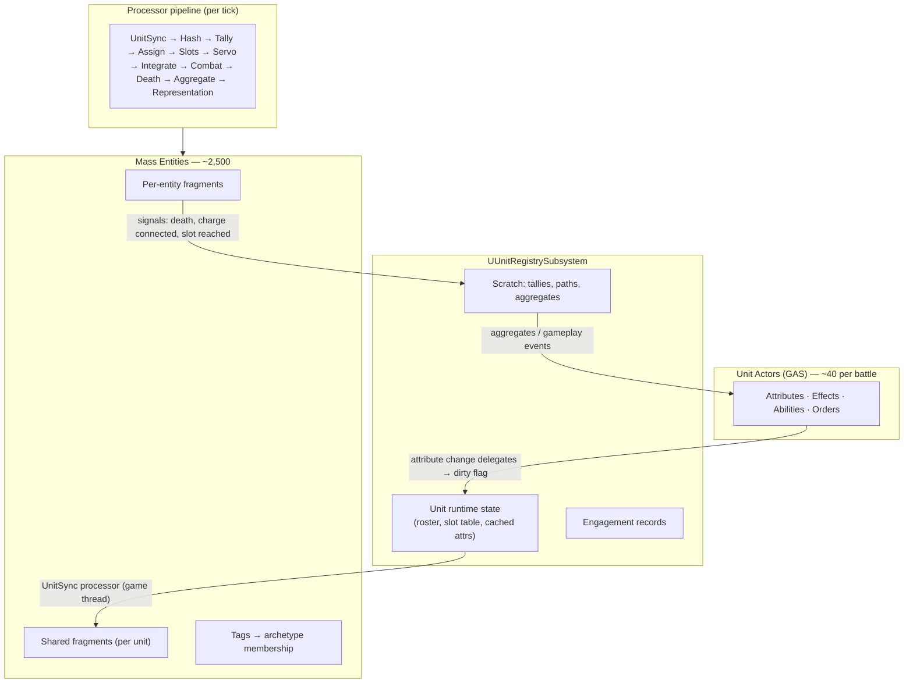
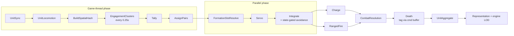

# Total War Battle System — Architecture Specification

**Project:** UE5 Mass Entity + GAS battle simulation (Medieval 2: Total War clone)
**Status:** Draft 1.1 · 2026-10-23 — review corrections applied (annotations marked `> **[REVIEW …]**`)
**Engine pin:** Unreal Engine 5.8.x — terminal UE5 release (ADR-13)
**Audience:** Implementation reference (solo developer)
**Companion:** `Docs/spec/roadmap-and-testing.md` (build order + validation) · `Docs/reviews/plan-review-findings.md` (full review evidence, register, and sources)

---

## 0. Decision Log

| ADR | Decision | Rationale |
|-----|----------|-----------|
| ADR-01 | Hybrid split: GAS actors for units, Mass entities for soldiers | Effect/buff authority lives on ~40 actors (cheap); ECS throughput serves ~2,500 bodies |
| ADR-02 | Registry translation layer; actors and entities never call each other directly | Workers can't touch UObjects; handle indirection survives GC; one clear boundary |
| ADR-03 | Shared fragments are the per-unit broadcast channel; mutate in place only | One copy per unit; zero churn; rebinding shared instances at runtime is forbidden. *Review 2026-10-23 (E1): Mass dedups shared fragments by content hash — uniqueness must be constructed; enforced by ADR-14.* |
| ADR-04 | GAS→entity propagation via sync processor (batched, 1-frame latency accepted); entity→unit via signals | No scatter writes mid-frame; no UObject access from worker threads |
| ADR-05 | Combat is sim-driven with timers; animation is cosmetic | Stable under LOD; avoids animation-locked "duel serialization" of modern TW |
| ADR-06 | Attack slot budgets are exposure-driven geometry, not constants | Reproduces M2TW mobbing (peasants pull down a knight) and shield-wall behavior with one system |
| ADR-07 | Unit = locomotor, entity = velocity servo; unit-vs-unit resolved at unit level | Eliminates force tug-of-war, symmetric deadlocks, racing anchor, cross-unit avoidance mush |
| ADR-08 | Heightfield movement (no navmesh) for open-field phase | Cheaper, matches TW feel; sieges are a later movement domain |
| ADR-09 | Closed GAS attribute set; effects target `*Mod` attributes only | Stacking resolution lives in one exec-calc per derived stat |
| ADR-10 | Three-band representation (skeletal actor / instanced+VAT / static ISM); sim state is the only channel to appearance | Zoom-to-ground moment preserved; crowds at one draw call per mesh/material |
| ADR-11 | Single-player first; multiplayer/determinism hooks designed but not implemented | GAS replication + Mass determinism is a different project shape |
| ADR-12 | Entity data schema mirrors M2TW EDU format | Community-reverse-engineered combat formulas and stat tables can be ported directly |
| ADR-13 | Engine pinned to **UE 5.8.x**; re-baseline against a new engine release only at phase boundaries via a scripted API-diff audit (I6) | Mass API churn across 5.6→5.8 is documented fact (batch element API renames, processor-execution overhaul, MassCore split); 5.8 is the terminal UE5 release, maximizing stability runway [Review E4] |
| ADR-14 | Every per-unit shared fragment embeds `FUnitHandle` in its payload and is created through a handle-seeded hash | Mass dedups shared fragments by content hash; two units with identical values would otherwise silently share one instance and cross-contaminate on in-place mutation [Review E1] |
| ADR-15 | `FDeadTag` is a **regular tag** (kill = archetype flip) -- the sparse-tag adoption was **REVERTED by the Phase 0 on-machine probe** (resolves roadmap Open Decision 7 / Review R1) | Probe findings (Task 9, audit C10/C11): 5.8.4 sparse tags are stored per archetype CHUNK (MassSparseElementsStorage.h -- "Sparse tags live there since they don't contain any data per instance"), so AddTag on one entity marks its whole chunk dead; and the observer registry rejects sparse elements entirely. Per-entity death marking requires the regular tag. The R1 churn concern is deferred (Phase 2 mass-death revisits chunking: one archetype per unit already localizes flips) |
| ADR-16 | **Jenkins LTS (portable: Temurin JDK 21 zip + jenkins.war, localhost-only) on the reference machine** is the R8 orchestration host; per-commit gate job (`massbattle-gate`, Jenkinsfile) + nightly cron job (`massbattle-nightly` → `Tools/CI/nightly.bat`) | A4 (owner-approved). Horde assumes farm infrastructure; hosted CI adds remote-runner friction with local LFS. Portable install avoids MSI/service footprint. Nightly drives the native Gauntlet framework directly on the staged build (5.8's `RunUnreal` UAT verb requires project-side Gauntlet test-node assemblies -- out of Phase 0 scope; the game-side controller + exit-code/log evidence proves the loop end-to-end). Install: `Tools/CI/JENKINS.md` |
| ADR-17 | **Route A (C++ archetype-first spawn) is the ONLY unit-spawn path; Route B (`UMassEntityConfigAsset` template spawn) is config-integrity validation only.** Template-baked shared fragments necessarily carry a null `FUnitHandle` anchor (a template cannot know a future unit handle), so every unit spawned from one config would share one null-anchored `FUnitStatsSharedFragment` -- the exact E1 cross-contamination ADR-14 forbids, and rebinding shared instances post-spawn is forbidden by §3.3. Config-spawned entities are used by T0.3 to prove the config→template→archetype chain resolves, never as battle units. Recorded by the Phase 0 audit (M8). | §5.3 Spawn, §3.3 |
| ADR-18 | **A2 order API gains a commanded-frontage field (`FUnitOrder::CommandedFiles`, `IssueMoveOrder(..., CommandedFiles=0)`); 0 keeps the layout, >0 re-lays files at order consumption (clamped to NumSlots).** Total War-style width control for the selection demo without widening the command surface beyond one field; NumSlots is preserved so casualty-reflow semantics hold, and the existing Generation-bump re-slot path does the layout change. Applied in UnitLocomotion's order-consumption block (single writer), gated by unit tests (Battle.Unit.Registry.OrderWidthOverride) + S4_WidthOverride func scenario. Also: `AUnitActor` gains editable `NumRanks`/`FormationSpacing` so level-placed units author formation in the editor; the selection/UI demo (capsules, picking, camera, HUD) lives in the game module `MassBattleGame` per owner decision 2026-10-25 -- demo code consumes registry orders + fragment reads only, no sim logic leaves the plugin. *Refront semantics (S5/S6, 2026-10-26): commanded FACING settles AFTER arrival (in-place rotation; en route the facing rides the path tangent); a zero-length plan stores no path (in-place reform); a layout re-decision (Generation bump) triggers an immediate UNBOUNDED nearest-slot re-assign; found + fixed a shipped sign bug in FUnitServo overlap avoidance (RelPos pointed toward the neighbor) plus a HoldSlot touch-gate (never enter the no-avoidance state while touching a teammate). FacingDeltaRate default 1.0 -> 0.35 rad/s so re-dress arcs track at walk speed.* **The refront clause of this ADR (facing settles after arrival; the arrival Generation-bump re-assign as the refront mechanism) is SUPERSEDED by ADR-19 (2026-10-27).** | Demo (Phase 5 selection/UI territory pulled forward), owner request |
| ADR-19 | **Formation movement adopts TW progressive fall-in & march discipline (owner plan 2026-10-27; `Docs/phases/phase-2/brief.md`): an order is an intent to converge.** Assignment (who owns which slot -- greedy while marching, ONE crossing-free sort-matched re-assignment when the destination blend engages, sort-matched outright when no path exists) is separated from targeting (per-entity blend `lerp(marchSlot, finalSlot, alpha)`, `alpha` from remaining path length with a per-soldier handoff latch). The final frame (anchor/facing/width) is armed at order consumption; the ARRIVAL Generation-bump re-assign and the ArriveRefront state are DELETED for marched moves (the H2 corridor width-restore keeps its re-slot). Servo: slot-velocity feed-forward + member-max clamp (arch §8.3 MaxSpeed = member max, not the anchor's pace); wheel cap marching form `AnchorCap = v_member * r/(r + HalfFrontage)`; straggler pace term throttles the anchor from the reduced max-slot-error metric (floored at 0.25, disabled inside the morph zone -- freezing crossed mid-blend targets cannot drain); march stickiness skips the interval reflow on a dressed march. Settle: rest-facing generalizes to field entities at a per-man rate (2 rad/s); the servo's arrival basin caps the final approach (damped 0.5 m/s close) so entities park at center and turn. Everything ships behind default-off `Battle.Movement.*` cvars (`FeedForward, MemberClamp, WheelCapV2, StragglerPace, DressBreak, PaceGain, MarchStickiness, ProgressiveFallIn, MorphDistance, HandoffDist, SettleYawRate`); fold-in to defaults after one green nightly with the flags on (phase-2 report carries the checklist). Measured deltas vs the plan's estimates are recorded in `Docs/phases/phase-2/report.md` (morph distance 24 m not 12 -- a facing flip needs the frontage rotation in the approach; settle ~5-9 s not 3 s; S5 rides a 0.75 m monotone-excursion tolerance). Evidence: S7_FallIn (the reported repro) green; unit 56/56; func 15/15 flag-off. | Reported defect (walk-past + double-back at destination; no dress on the march), owner-approved plan |

## 1. Scope

In scope: real-time field battles — formed movement, engagement duels with mobbing, charges, direct/indirect ranged fire, morale/routing, LOD presentation for ~2×2,400 entities. Out of scope v1: sieges/walls, naval, campaign, multiplayer.

Source-of-truth rules: **unit actor = authority and interface; registry = translation layer; shared fragments = broadcast channel; signals = uplink.**



## 2. Domain Model & Ownership

**2.1 Unit actors (GAS).** Own: attributes, gameplay effects, abilities, orders, morale/fatigue authority, selection/UI. One actor per unit; entity composition declared as a roster spec (e.g., 1 sergeant, 42 footmen, 1 guidon bearer).

**2.2 Entities (Mass).** Pure data + tags. No GAS, no per-entity abilities — "attacks" are weapon stat entries plus timers consumed by processors.

**2.3 Registry (`UUnitRegistrySubsystem`).** World subsystem holding: `TMap<FUnitHandle, FUnitRuntimeState>` where `FUnitHandle{ uint32 Index, Serial }` (generation counter detects stale handles); runtime state contains roster `TArray<FMassEntityHandle>`, slot table, cached plain-struct attribute snapshot, unit kinematics, engagement records. All game-thread written, worker-read safe via plain structs.

**2.4 Linkage.** Entity→unit: `FOwnerUnitFragment` (handle + roster index). Unit→entity: roster array. Both sides communicate only through the registry.

## 3. Fragments, Tags & Archetypes

**3.1 Rules.** Fragments are USTRUCTs deriving `FMassFragment` / `FMassSharedFragment` / `FMassTag`; engine auto-registers derived types. Hot fragments are blittable-friendly — no `FString`, no `UObject*`, no `TArray`; indices and handles only.

| Fragment | Kind | Written by | Contents |
|----------|------|-----------|----------|
| `FOwnerUnitFragment` | per-entity | spawn fixup | unit handle, roster index |
| `FLoadoutFragment` | per-entity | spawn | table row index, mesh/weapon IDs |
| `FBaseStatsFragment` | per-entity | spawn, immutable | EDU-mapped base stats |
| `FHealthFragment` | per-entity | combat resolution | current HP, queued damage |
| `FTransformFragment` / `FVelocityFragment` / move targets | per-entity | engine movement stack | position, velocity, servo output |
| `FSlotAssignmentFragment` | per-entity | slot resolve / reflow | slot index + generation counter |
| `FCombatIntentFragment` | per-entity | unit AI stage | behavior state, target unit, lane index |
| `FCombatPairFragment` | per-entity | assign pass | target handle, contact angle, state (Seeking/Pressing/Striking/Recovering), attack timer, pair age |
| `FChargeFragment` | per-entity | charge processor | charge distance, impact speed, connected flag |
| `FRangedStateFragment` | per-entity | ranged processor | reload timer, ammo, target |
| `FUnitStatsSharedFragment` | **shared** | UnitSync | unit handle (ADR-14 uniqueness anchor) + derived stat multipliers (§9.3) |
| `FUnitFormationSharedFragment` | **shared** | unit locomotion | unit handle (ADR-14), anchor, facing, spacing scale, layout params, generation |
| `FUnitStateSharedFragment` | **shared** | unit AI | unit handle (ADR-14), unit mode enum, order context |

> **[Phase 1 A7-pattern patch · 2026-10-24, brief Task 1 authorization]** The `FVelocityFragment` concept above is adopted as the **engine `FMassVelocityFragment`** (`MassMovement/Public/MassMovementFragments.h:19`, `FVector Value`, "actual physical velocity"): MassMovement is linked (phase1 Build.cs), the struct is a trivial blittable type, and duplicating it as a project `FVelocityFragment` would create a second name for the same bytes and a query/processor mismatch hazard. The Servo writes it, Integrate consumes it; no engine movement/avoidance processor runs on battle entities (decision A1). Audit record: `Docs/reference/engine-api-5.8.md` Part A §14.

**3.2 Capability model.** Processors are global singletons selecting entities by query requirements; behavior does not live on entities. Tags (`FInfantryTag`, `FCavalryTag`, `FMeleeTag`, `FBowTag`, `FCrossbowTag`, `FOfficerTag`, `FBannerTag`, `FHardyTag`, `FImpetuousTag`…) are zero-memory archetype filters. A spearman has no ranged fragments, so the ranged-fire processor never touches his chunks. New entity types are usually new data, not new code; new processors appear only for genuinely new capabilities. Combat-mode switching: preferred method is tag swap (batched at pipeline boundaries); acceptable fallback is a mode enum in a fragment.

**3.3 Shared fragments.** One instance per unit, created at spawn, then mutated **in place** — what shared fragments buy is one copy per unit plus chunk-grouped iteration. Rebinding entities to different shared instances at runtime is forbidden (archetype/churn hazard).

> **[REVIEW E1 · 2026-10-23 — corrected]** The original text called the hash-dedup "incidental." It is adversarial: Mass deduplicates shared fragments **by content hash** — "configs with the same settings will share the same Shared Fragment," and `GetOrCreateSharedFragmentByHash` returns the existing instance for any byte-identical payload (MassSample §4.2.1; verified 2026-10-23). Two freshly spawned units with identical stats therefore receive **one shared instance**, and UnitSync's in-place mutation writes through to every unit sharing it — silent cross-unit stat corruption during combat, no assert, no archetype change. Uniqueness is constructed, not free (ADR-14): every per-unit shared fragment embeds `FUnitHandle` (index + serial) as its first field, creation goes through a handle-seeded hash (`HashCombine(Index, Serial)`), and T0.8 asserts N identical-stat units yield N distinct instances. Full evidence and citations: findings file §E1.

**3.4 Archetype budget.** Expect ~15 entity types × lifecycle variants (alive/dead/routing). Unbounded composition growth — per-entity unique data stamped as fragments — is the smell to watch; such data belongs in shared fragments or the registry.

## 4. Processor Pipeline



| # | Processor | Reads | Writes | Thread |
|---|-----------|-------|--------|--------|
| 0 | UnitSync | registry dirty state | shared stat/formation fragments | game |
| 1 | UnitLocomotion | registry, cost grid | anchor/facing/speed-limit into shared | game |
| 2 | BuildSpatialHash | transforms | spatial hash (subsystem) | game |
| 3 | EngagementClusters | unit envelopes | engagement records | game, 4 Hz |
| 4 | Tally | combat pair fragments | scratch per-defender tallies | game |
| 5 | AssignPairs | intents, pairs, hash, records | combat pair fragments | game |
| 6 | FormationSlotResolve | slot assignment + shared formation | move targets | worker |
| 7 | Servo | move targets, shared, states | velocities | worker |
| 8 | Integrate (+ state-gated engine avoidance) | velocities | transforms | worker |
| 9 | Charge / RangedFire | charge, weapon frags | charge state, projectile spawns | worker |
| 10 | CombatResolution | pairs + shared stats | HP, damage | worker |
| 11 | Death | HP ≤ 0 | `FDeadTag` + signal | via command buffer |
| 12 | UnitAggregate | all live | per-unit aggregates | worker → game merge |
| 13 | Representation + engine SimLOD | transforms, tags | ISM/actor migration | last |

**Threading rules.** Access requirements in `ConfigureQueries()` fully declare what is touched; the access detector derives parallel safety. Game thread: sync, locomotion, hash build, tally, assign (target < 0.5 ms at ~1k in contact). Never add/remove tags or destroy entities inside `ForEachEntityChunk` — queue on the command buffer.

> **[5.8 API note — Task 2 audit, 2026-10-24]** Pinned 5.8.4 processor signatures: `ConfigureQueries(const TSharedRef<FMassEntityManager>&)`, `Execute(FMassEntityManager&, FMassExecutionContext&)`, queries registered in the processor constructor (`FMassEntityQuery Query(*this)` — `RegisterWithProcessor` still exists but is not the pattern; `RegisterWithProcessor`-era `ConfigureQueries()` parameterless form is gone). `ExecutionFlags` CDO default is `Server|Standalone` — editor-world processors must set `EProcessorExecutionFlags::AllWorldModes` explicitly. Command-buffer flush contract (resolves the E5 block above): 5.8.4 flushes deferred commands at the end of each processor's processing scope (observers fire during the flush, unlocked just before it) and again at processing-phase end for the manager-level buffer — row 11's "same tick" therefore means "before the next processor in the same phase observes state". Full evidence and source paths: `Docs/reference/engine-api-5.8.md` (§2, §3).

> **[REVIEW E5 · 2026-10-23]** Command-buffer **flush points must be stated, not assumed**: Mass flushes buffers when a processing context is destroyed (flush-on by default) and at processing-phase end; 5.8 overhauled processor execution, so the exact flush discipline must be verified once against the pinned 5.8.x source and recorded here. Consequence for row 11: the Death processor either flushes its buffer explicitly before UnitAggregate executes, or T0.5's "same tick" is re-scoped to "no later than end of phase, never visible to combat resolution in the following tick." Also, "archetype flip removes entities at chunk granularity" is imprecise: a tag add/remove moves *individual entities* between chunks — and 5.8's sparse tags eliminate the move entirely (see R1).

## 5. Unit–Entity Interaction

**5.1 Down (GAS → entities).** Unit subscribes `GetGameplayAttributeValueChangeDelegate` in `PostInitializeComponents`; the handler updates the registry's cached plain-struct snapshot and sets a dirty flag. `UnitSync` (first in pipeline) copies derived values into shared fragments — one write per unit per change. One frame of latency is accepted for buffs; the instant path (damage, death) goes through signals.

**5.2 Up (entities → GAS).** `UMassSignalSubsystem` for discrete events (entity died, charge connected, slot reached, banner fell) → registry aggregates on game thread → `SendGameplayEventToActor`. `UnitAggregate` computes per-unit counts (alive, engaged fraction, ammo fraction); chunk-grouped iteration via shared fragments is a locality bonus — the roster in the registry remains authoritative bookkeeping.

**5.3 Lifecycle.**
- **Spawn:** roster spec → batched `UMassSpawnerSubsystem::SpawnEntities` per role (5.8 template-based spawning via `FMassEntityTemplate`; the pre-5.8 name `SpawnEntitiesFromConfig` is obsolete) → fixup pass (owner handle, base stats, initial slots). Deferred/batched paths mandatory.

> **[REVIEW E4 · 2026-10-23]** Engine version is now pinned (header, ADR-13): **UE 5.8.x**. Every Mass symbol in §3–§5 must be re-verified against the 5.8 API reference in one audit pass (I6 automates this per engine upgrade): 5.8 renamed batch element APIs (`AddElementToEntities` → `BatchAddElementToEntities`), unified command-buffer element commands, moved Mass Signals into engine core, and split out `MassCore`. 5.8 also permits **off-game-thread entity creation** (archetype-based, lock-free scheduling) — the game-thread-only rule in ADR-02 is now a choice, not an engine limit; record it as such and revisit when the T6.2 perf gates demand it [I1].

- **Death:** combat resolution queues `FDeadTag` (removes the entity from all live queries) + signal → corpse representation state → deferred destroy → roster updated on game thread.

> **[REVIEW R1 · 2026-10-23]** Evaluate **5.8 sparse tags/fragments** for `FDeadTag` and §3.2's combat-mode tag swaps: sparse/virtual fragments add/remove optional fragments and tags *without archetype changes*, eliminating the hottest structural churn in this pipeline (mass death events during a routing collapse; §3.2's "batched at pipeline boundaries" caveat simplifies). Decide at Phase 0 while the death path is first built.
- **Stat stacking:** every derived stat resolves in one exec-calc with a fixed additive/multiplicative order — effects never resolve against each other ad hoc.

## 6. Unit AI & Command Layer

**6.1 Commands.** `Move`, `AttackMove`, `AttackUnit`, `Stop`, `Withdraw`, drag-place (sets anchor + facing + width). Toggles: `GuardMode`, `FireAtWill`/`HoldFire`, `SkirmishMode`, `RunToggle`, formation presets (line/column/square/wedge/schiltron — each a layout-function preset).

**6.2 Unit FSM.** Idle / Move / AttackMove / AttackUnit / Engaged / Routing, with `OrderLatency` gating response (command-rating flavor). Target selection is three layers: unit picks enemy *unit* → engagement solver picks *pairs* → entities execute.

**6.3 Engagement records.** Flood-fill cluster graph over unit contact envelopes, recomputed at 4 Hz. One `FEngagementRecord` per (attacker, defender) pair: `Mode` (Frontal/Flank/Mob), `FrontageStart/End` (segment of defender line; flanks wrap the end), `DesiredPressure` (unit-level overkill cap: frontal = defenderCount × FormedSlots; mob = min(attackerCount, defenderCount × 2–3)), `AssignedAttackers` (tallied fresh each tick). Attacker units subdivide their frontage segment into one lane per attacking file; `FCombatIntentFragment.LaneIndex` restricts candidate targets. Records are independent → per-cluster sharding is the scaling escape hatch.

## 7. Engagement Solver

**7.1 Spatial hash** (`UBattleSpatialHash`, world subsystem). Uniform grid, 3 m cells, entries `{entity handle, unit handle, flags, radius, reach class}`. Rebuilt each tick on game thread from end-of-last-tick transforms via two-pass counting sort into preallocated arrays (zero per-tick allocation). `QueryCircle` used for coverage and mob targeting only — formed-fight targeting reads defender slot tables (data, not proximity).

**7.2 Two-phase pass.** *Tally:* iterate live `FCombatPairFragment`s, count attackers per defender in a scratch open-address table; everything derived fresh each tick — no state to desync. *Assign:* single game-thread pass (pseudo-code below). Seeker iteration shuffled per tick with seeded RNG; deterministic mode switches to index-sorted iteration with per-entity jitter.

```cpp
// per seeker: validate → eligibility → candidate → budget → assign
if (Pair.Target.IsValid() && !IsValidTarget(Pair.Target)) Release(Pair);   // died / stale serial
if (BeyondBreakDistance(Pair) && Pair.PairAge > Hysteresis) Release(Pair);
if (Pair.Target.IsValid()) continue;
auto& Rec = Registry.GetEngagement(Owner, Intent.TargetUnit);
if (Rec.AssignedAttackers >= Rec.DesiredPressure) continue;                // unit-level cap
auto T = (Rec.Mode == Mob) ? FindMobTarget(Hash, Rec)                      // circle query
                           : FindLanedTarget(DefenderSlotTable, Rec);      // in-lane scan
if (!T.IsValid()) { Pair.State = Pressing; continue; }                     // press the line anyway
float Cov = CachedCoverage(T);
if (Scratch.Tally(T) >= SlotBudget(T, Cov, Attacker)) continue;
Pair.Target = T;  Pair.ContactAngle = PickExposedAngle(T, Cov);
Pair.State = Pressing;  Pair.AttackTimer = StaggeredDelay(Entity);
Scratch.Tally(T)++;  Rec.AssignedAttackers++;
```

**7.3 Budgets & coverage (the mobbing model).**

```cpp
int32 SlotBudget(D, Coverage, Attacker) {
    int32 B = Lerp(MaxMobSlots /*6–8*/, FormedSlots /*2*/, Coverage);
    if (Attacker.ReachClass >= Spear) B += SecondRankBonus;   // spears strike through the front rank
    return Max(1, B);
}
float Coverage(D) = Min(1, SameUnitLivingNeighborsWithin(Pos(D), Spacing(D) * 1.25) / NeighborsForFullCoverage);
```

`PickExposedAngle` quantizes the defender's surroundings into 8–12 sectors and fills *exposed* sectors first (covered arcs open only when exposed are full). `ContactAngle` drives both contact-ring steering and directional defense lookup — one value, two consumers.

**7.4 Waiter behavior.** Unslotted attackers press to *contact ring* (radii + weapon reach — never queue distance), mill with RVO inside the mob radius only, and take slots within 1 tick of release plus 1–3 tick jittered backoff for failed seekers. Attack timers are independent with phase offsets — combat is never serialized. Emergent properties: casualty → coverage drop → budget increase (shield-wall meltdown); opened mob budgets mid-pass-through (vulnerability windows).

**7.5 Pair lifecycle.** Release on target death/stale handle; distance breakup with 0.3–0.5 s hysteresis; re-pair = attackers advance into vacated slots (not a special case — it *is* the handoff). Routers (`FRoutingTag`): budgets bypassed (perf cap only), chase state, rear-arc resolution. Charging entities bypass pairing until impact seeds their first pair. Disengage/rout of a unit flags its records dead → mass release of inbound pairs.
## 8. Movement

**8.1 Doctrine.** The unit is the locomotor (path, anchor, facing, speed limit, spacing scale); entities are velocity servos. All classic failure modes — force tug-of-war, symmetric avoidance deadlock, racing anchor, index-mapped reassignment treks, cross-unit avoidance mush — are resolved by this layer split, not by avoidance tuning.

**8.2 Unit locomotion** (registry, game thread, ~40 iterations; writes shared formation fragment).

```cpp
// Wheel cap stated in two explicit steps so every dimension is auditable (v m/s, w rad/s, r m):
const float OmegaMax = MaxMemberSpeed / FMath::Max(OuterRadius, KINDA_SMALL_NUMBER);                  // rad/s
const float WheelLinearLimit  = OmegaMax * FMath::Max(PathRadiusOfAnchor, KINDA_SMALL_NUMBER);        // m/s
const float FacingLinearLimit = FacingDeltaRate_rad_s * FMath::Max(PathRadiusOfAnchor, KINDA_SMALL_NUMBER); // commanded facing-change rate, rad/s

UnitSpeedLimit = Min3(CommandedSpeed,                                              // order intent
                      MinOverMembers(EffectiveSpeed(i) * CatchupFactor /*1.25*/),  // slowest man
                      Min(WheelLinearLimit, FacingLinearLimit));
```

> **[REVIEW E2 · 2026-10-23 — corrected]** The original third term, `MaxMemberSpeed / OuterRadius * FacingDeltaRate`, was dimensionally inconsistent: `speed ÷ radius` yields rad/s, and multiplying by an undefined `FacingDeltaRate` cannot produce the linear limit the formula claimed — two implementers could build two different systems from that line. The cap is now two-step: ωmax = v_max / R_outer, then v_wheel = ωmax · r_path(anchor) (outer radius for an in-place pivot, path radius during a moving wheel), with `FacingDeltaRate` defined as the commanded facing-change rate in rad/s applied as a separate linear cap. Locked behind golden tests in T1.3 (degenerate radii, straight-march inactivity).

The exhausted flanker slows the whole unit until re-dressed (authentic fatigue gameplay through movement) -- **implemented as the phase-2 straggler pace term: FormationSlotResolve reduces `MaxSlotErrorM` per unit; the anchor's limit is throttled by `StragglerPaceFactor` (linear beyond `DressBreak`, floored at 0.25 -- a fully frozen anchor recovers slower than a creeping one; disabled inside the fall-in morph zone where the "tear" is the intended shape change), riding the hysteresis below.** Hysteresis on the limit. Compression: slot = `anchor + R(facing) · LayoutFn(slot) · SpacingScale`, floor ~60% of nominal spacing, recovery ~10%/s. Hard rule: no facing change while interpenetrating another unit.

> **[Phase 2 ADR-19 amendment · 2026-10-27]** The wheel cap gains a MARCHING form for path traversals: the path-frame layout wraps ranks ALONG the path, so the outer files sweep `r_path + HalfFrontage` -- not the formed-body outer radius about the centroid (the pivot form, kept for in-place rotations). `OmegaCap = MaxMemberSpeed / (r_path + HalfFrontage)`; `AnchorCap = OmegaCap · r_path`. Behind `Battle.Movement.WheelCapV2` until the nightly folds it.

**8.3 Entity servo.** `V = clamp((SlotPos − Pos) / Tau, MaxSpeed × CatchupBoost)` with acceleration clamping — velocity control, never force accumulation. **Phase 2 (ADR-19): `MaxSpeed` means the MEMBER's own max (`WalkSpeed × SpeedMult`), not the anchor's pace -- a wheel's outer files quickstep while the anchor slows; and the servo gains a slot-velocity feed-forward form `V = clamp(V_slot + (SlotPos − Pos)/Tau, MaxSpeed × CatchupBoost)` with `V_slot` from the resolve stage's previous target write (velocity matching on a moving target; the systematic Tau·v trailing lag collapses to ~0). Inside the settle basin (2×SlotReachEps) the commanded speed is capped (0.5 m/s damped close) so entities converge to the slot center, stop, and turn.** Avoidance is a per-state weight, never global:

| State | Servo target | Avoidance | Conversion (R2) |
|-------|-------------|-----------|-----------------|
| HoldSlot | slot | **none** (servo + compression own crowding) | n/a -- velocity-space native |
| ManeuverToSlot | slot | medium, teammates only | n/a -- velocity-space native |
| CrossField | slot, boost | full RVO + asymmetric tie-break | n/a -- velocity-space native |
| PressRing | contact-ring point | RVO within mob radius | n/a -- velocity-space native |
| Charge | impact point | none | n/a -- velocity-space native |
| Flee | flow away | light scatter | n/a -- velocity-space native |

> **[A1 patch · 2026-10-24, phase-1 brief §3.1 authorization]** The R2 conversion column is "n/a -- velocity-space native" for every state: decision A1 implements the avoidance column as per-state weights on a project velocity-space term inside Servo/Integrate (no engine force pipeline, no `FMassForceFragment` consumption). The engine's steering pipeline is the same math in different units (engine-api §14: `SteerK*(Steering.DesiredVelocity - DesiredVelocity)` is structurally the §8.3 servo); R2's conversion question dissolves rather than being answered. Engine avoidance remains a contingency (A1 Option B) only if CrossField RVO underperforms T1.5/T1.6.

> **[REVIEW R2 · 2026-10-23]** The engine's Mass Avoidance is a **force-based** system (outputs a steering force into `FMassForceFragment`) and remains **Experimental** — blending it into this velocity servo requires an explicit force→velocity conversion policy per state (convert with a mass/accel clamp, or consume as a weighted steering direction before the servo clamp) plus a decision on which states bypass it. Add a conversion column to the table above before Phase 1; T1.5/T1.6 assertions pin the resulting behavior (no pairwise stalls, bounded wake recovery).

**8.4 Slot assignment & targeting.** Locality-aware reflow (greedy per-file fill; entities bid for nearest vacant slot), batched (~0.5 s or on detected rank gap) — never per-casualty instant. Predictive swaps: same-unit pairs whose servo paths cross within ~1 s swap slot indices. **Phase 2 (ADR-19) splits assignment from targeting: who owns which slot is decided per order (greedy-nearest while marching -- it also drives the alpha≈0 march targets), then re-decided ONCE, crossing-free, by sort matching (`AssignFinal`: the i-th front-most entity takes the i-th front-most slot on the final layout's projection axes, deterministic projection → lateral → roster tie-breaks; casualty holes land at the rear) when the destination blend engages; with no path (in-place reform, post-arrival) the final layout IS the operative layout and sort matching owns re-decisions and rank gaps. The per-entity TARGET is a blend `lerp(marchSlot, finalSlot, alpha)` with `alpha = clamp01(1 − Remaining/MorphDistance)` (floored at 2× rank depth) and a per-soldier handoff latch (within `HandoffDist` of the final slot → locked, hysteresis 1.5×). Interval reflow + predictive swaps are skipped while a path is active and the block is dressed (march stickiness) and while the final layout owns a pathless unit.**

**8.5 Unstuck ladder** (per entity, speed < ε for T while not near slot): 1) double avoidance weight → 2) sidestep impulse ⊥ servo → 3) forced slot swap with blocking teammate → 4) escalate to unit AI (displacement < ε → temporary column, sidestep order, or hold). Every step logged and colored in the debug overlay.

**8.6 Unit-vs-unit policies & special geometry.** Unit bodies (OBB) resolve contact as *yield / block / pass-through* (policy by friendliness, mass, mobility, right-of-way). Cavalry through friendly infantry = pass-through with shove: cavalry anchor proceeds at ~50–60% speed with lowered compression floor; infantry entities in the computed overlap zone receive displacement velocity blended over the servo (`w = clamp(MassRatio × OverlapDepth)`), servo recovers the wake for free. Optional "make way" corridor: layout function temporarily inserts a gap band, halves re-slot locally, gap closes with a normal reflow. Narrow passes: if `PassWidth ≥ FormationWidth × CompressionFloor` → squeeze; else **morph** to column (files = floor(PassWidth / FileSpacing)) via layout re-parameterization + locality re-slot. Long columns use **path-frame layout**:

```cpp
SlotPos = PathPoint(s_anchor − rank · RankSpacing)                    // arc-length behind anchor
        + PathNormal(s) · (file − (files−1)/2) · FileSpacing;         // lateral in path frame
// per-rank facing = local path tangent; degenerates to anchor+R(facing) on straight paths
```

Commit rule: morph locks once the lead rank crosses the mouth (no re-decision mid-corridor). Queue points before occupied chokes (unit-level, never entity crowding). Re-deploy width only past exit clearance. Deadlock in a one-way corridor: priority by order age/mass, loser's anchor reverses along the path (path-frame layout traverses in reverse natively).

## 9. Combat Resolution

**9.1 Melee.** Attacker-side rolls on sim timers; the defender holds no combat authority (avoids defender-driven serialization). Hit chance = `clamp(f(Attack × MeleeAttackMod × FatigueAttackMult, Defense), floor, cap)` where `Defense = DefenseSkill(arc) + Shield(frontal arcs) + Armor` and armor-piercing weapons halve armor. Port the community-reverse-engineered RTW/M2TW formulas and clamps rather than inventing. Damage vs HP: humans are 1 HP (a hit kills); mounts carry a second HP pool. Spear-class reach grants second-rank attacks through the front rank (§7.3).

**9.2 Charges.** Per-entity charge state (acceleration, distance traveled); charge bonus applies only on fresh contact at speed; knockback/knockdown on impact; morale shock; decays to normal melee within seconds. Contact direction (from `ContactAngle`) drives flank/rear bonuses. Cavalry = single entity with composite rider+mount stats.

**9.3 Ranged.** Pooled instanced projectiles (never per-arrow actors); ballistic arcs (bow) vs flat trajectory (crossbow); dispersion; rank-limited volley rules; LOS via heightfield sampling; shield protects frontal arcs only; per-entity ammo in `FRangedStateFragment`, unit-level authority (out-of-ammo flips a unit tag when the aggregate hits zero). Friendly-fire rules from impact-point checks.

## 10. Attributes, Abilities & Effects

**10.1 Unit GAS attribute set (closed).**

| Attribute | Role |
|-----------|------|
| `Morale` | break/rout decisions; fed by the contribution stack (§10.5) |
| `Fatigue` | accumulates from exertion; quantized into fatigue states |
| `Experience` | chevrons — small attack/defense/morale bonus |
| `ArmourUpgrade` | armory upgrades (additive) |
| `MeleeAttackMod` / `MeleeDefenseMod` / `RangedAttackMod` / `SpeedMod` / `BlockChanceMod` | the only targets of buff/debuff effects |
| `OrderLatency` | command response delay |
| `AmmoPool` | aggregate for UI / out-of-ammo state (authority: unit; counts: per-entity) |

**10.2 Entity stats mirror the EDU schema:** `stat_health` → HP pools (rider/mount); `stat_pri`/`stat_sec` → weapon entries (attack, charge, projectile kind, range, ammo per man, AP flag); `stat_pri_armour` → armor / defense skill / shield; `stat_mental` → morale base + discipline tags; `formation` → spacing; attributes line → behavior tags; `stat_heat` → climate fatigue coefficient. Ship the entity table in EDU format and parse at cook time.

**10.3 Derived shared stat block** (`FUnitStatsSharedFragment`): `SpeedMult, MeleeAttackMult, RangedAttackMult, MeleeDefenseMult, BlockMult, FatigueAttackMult, FatigueDefenseMult, ArmorAdd, AccuracyMult, MoraleBonus` — each = base × modifier attributes × fatigue/terrain/weather factors, computed in UnitSync. Entities and combat processors read only this.

**10.4 Abilities.** *Command family:* Move / AttackMove / AttackUnit / Stop / Withdraw / drag-place. *Toggle family:* GuardMode, FireAtWill/HoldFire, SkirmishMode, RunToggle, formation presets. *Triggered family:* Rally (general), WarCry / TerrorAura (frighten units), Charge, CantabrianCircle, impetuous auto-pursue (discipline tag). Entities have **no** GAS — weapon data + timers only.

**10.5 Effect catalog & morale stack.**

| Effect | Modifies | Notes |
|--------|----------|-------|
| FatigueState (fresh→exhausted) | attack/defense/speed multipliers | ticked by exertion; quantized states |
| TerrainPenalty (mud/snow/slope) | `SpeedMod`, fatigue rate | ground material / heightfield lookup |
| WeatherRain | `RangedAttackMod`, range | wet bowstrings (M2TW mechanic) |
| GeneralAura / TerrorAura | `MoraleBonus` / Morale drain | radius from general / frighten units |
| ChargeWindow | charge state + impact morale shock | seconds-scale decay post-impact |
| OrderDelay | `OrderLatency` | command rating |

Morale contribution stack (recomputed on an explicit clock — **not** a passive exec-calc: GAS exec-calcs fire on aggregation events (effect apply/remove/invalidation), never on their own timer. Preferred: a periodic, infinite-duration `MoraleTick` gameplay effect, period 0.25–0.5 s (§12 tunable), whose period execution runs the exec-calc over sim-fed SetByCaller inputs; alternative: a sim-side accumulator that applies an instant evaluation GE each period. The fresh-casualty spike decay is a sim-tracked term pushed in each period — GAS has no immanent time decay for exec-calc inputs [REVIEW E3 · 2026-10-23]; all weights tunable): base mental · casualty fraction · **fresh-casualty spike** · local engagement odds (from pairing tallies) · flanked/rear arc exposure · routing friends nearby (cascade) · general proximity + general-death shock · height advantage · winning locally. Discipline tags modify break resistance and rally chance. Thresholds: wavering → breaking → rout. Battles are won by morale collapse, not HP attrition — tune this stack before combat math.

## 11. Representation

**11.1 Bands.**

| Band | Distance | Representation | Budget |
|------|----------|----------------|--------|
| Near | < ~25 m | Skeletal actors + AnimBP (MassActors) | ≤ 150 pooled |
| Mid | 25–120 m | ISM + AnimToTexture (baked clips) | draw-call bound only |
| Far | > 120 m | ISM static pose + per-instance bob | remainder |

> **[REVIEW E6 · 2026-10-23]** AnimToTexture remains **Experimental** in 5.8 (`/Engine/Plugins/Experimental/AnimToTexture`) and has already broken baked assets once across an upgrade (5.2→5.4 data-format/tooling change). Phase 5 pre-tasks: pin the plugin version with the engine pin (ADR-13); keep the bake pipeline re-runnable from source (skeletal clips + editor/cook-time bake script — baked textures are never the only committed artifact); T5.4's nightly fails if mid-band VAT animation is frozen. Fallback ladder if a future release breaks the plugin beyond a local fix: Niagara mesh-rendering VAT or hand-authored instanced flipbook.

**11.2 Interface.** Per-instance custom data ≈ 6 floats: `ClipId, Phase, SecondaryBlend, VariationSeed, TintParam, SpeedParam`. `Phase` is slaved to the sim `AttackTimer` so the visible swing lands on the resolution beat. Updates are dirty-only and batched. Clip library is deliberately small (walk/run/attack variants/hit react/block/deaths/idle) — M2TW's entire crowd vocabulary.

**11.3 Variation & identity.** 2–3 mesh variants per type in separate ISM pools; per-seed tints; heraldry via SubUV atlas on shields; officers/guidon bearers are flagged entities with distinct meshes and banner attachments (their deaths are already morale signals — the "banner falls" beat rides the same event).

**11.4 Death.** Near: death clip on actor → corpse ISM instance (baked death poses, oriented from last transform). Mid: direct to corpse. Far: remove, corpse only within corpse-render distance. Corpses persist (pooled ~2,000, recycle oldest, slow fade) — the carpeted battlefield is the M2TW aftermath signature.

**11.5 VFX/SFX aggregation.** Per-entity particles only for near-LOD hit events (via signals), globally voice-capped; engaged units get unit-level ambient (melee dust, battle-din intensity from engagement tallies, march loop). Volleys = one Niagara batch per volley; arrow-stick decals pooled. Per-entity collision is forbidden — picking reads ISM transforms on click.

**11.6 Plumbing.** LOD band hysteresis (overlap + hold time); pooled actor churn with staggered migration; prefer late promotion to skeletal; `FMassActorFragment` valid only while representing as actor — sim logic never caches it; render smoothing bridges variable-tick simulation.

## 12. Consolidated Budgets & Tunables

| System | Value |
|--------|-------|
| Entities per battle | ~2 × 2,400 target |
| Skeletal actors / corpse ISMs | ≤ 150 / ≤ 2,000 pooled |
| ISM draw calls / custom floats | ~15–25 / ≤ 8 (derivation asserted in T5.5: variants × unit types + corpse pool + projectile pools [R13]) |
| Pairing pass (game thread) | < 0.5 ms @ 1k in contact |
| Servo Tau / catch-up / compression floor | 0.25 s / 1.25× / 60% |
| Wheel rate | ωmax = v_max / R_wheel; v_wheel = ωmax · r_path(anchor); R_wheel = r_path + HalfFrontage with a path active (marching form, ADR-19), OuterRadius for the in-place pivot [E2, ADR-19]; separate facing cap = FacingDeltaRate(rad/s) · r_path |
| Phase 2 movement (ADR-19) | MorphDistance 24 m (floored at 2× rank depth) · HandoffDist 0.7 m (latch 1.5×) · DressBreak 1.8 m · PaceGain 0.2 (factor floor 0.25) · SettleYawRate 2.0 rad/s · settle-basin cap 0.5 m/s inside 2×SlotReachEps · march-stickiness reflow skip on a dressed march |
| Morale tick period (E3) | 0.25–0.5 s |
| Reflow interval / unstuck ε,T | 0.5 s / 0.2 m·s⁻¹, 1.5 s |
| FormedSlots / MaxMobSlots / coverage neighbors | 2 / 6–8 / ~6 |
| Break distance / hysteresis | ring × 1.5 / 0.4 s |
| Mob overkill cap | defender × 2–3 |
| Cell size / seek radius | 3 m / 12–15 m |

## 13. Open Decisions

1. **Multiplayer** — decide before Phase 2; determines whether sorted/deterministic iteration becomes mandatory now (ADR-11 hooks exist).
2. **Statistical far-LOD combat** — probabilistic per-unit attrition beyond sim range; post-hardening, not v1.
3. **Exact M2TW constants** — hit-chance clamps, fatigue multiplier tables, shield arc coverage: port from community reverse-engineering (RTW/M2TW modding forums) during the formula audit.
4. **"Make way" corridor** — optional policy tier; ship shove-only first, add corridor if playtests demand.
5. **Siege movement domain** — out of scope v1; ladders/walls/gates are a separate movement domain.
6. **Deterministic replay** — design hooks only (seed registry, iteration option) unless replay/netcode is greenlit.
7. **Sparse-fragment adoption (R1, review 2026-10-23)** — whether `FDeadTag` and combat-mode switches use 5.8 sparse tags (no archetype churn) instead of tag-swap archetype moves; decide at Phase 0 while the death path is first built.

---

## 14. Review Findings Register (2026-10-23)

Review verdict: **approvable for Phase 0 after the corrections applied above** — the architecture's shape is unchanged. Errors E1–E6 are corrected in the text at the marked `> **[REVIEW …]**` blocks. Full reasoning, evidence, and citations live in `Docs/reviews/plan-review-findings.md`; roadmap/test-gate changes live in the companion roadmap §B.9.

| ID | Sev. | Location in this doc | Finding / action | Status |
|----|------|----------------------|------------------|--------|
| E1 | Crit | ADR-03/14, §3.1, §3.3, §5.1 | Shared-fragment content-hash dedup breaks per-unit uniqueness → handle in payload + handle-seeded creation hash; T0.8 | Corrected in text |
| E2 | High | §8.2, §12 | Wheel-rate formula dimensionally inconsistent → two-step ωmax/v_wheel with explicit units; golden tests (T1.3) | Corrected in text |
| E3 | High | §10.5, §12 | "Periodic exec-calc" is not a GAS execution model → explicit tick mechanism (MoraleTick GE or sim-owned); T4.8 | Corrected in text |
| E4 | High | Header, §5.3 | Engine version unpinned; pre-5.8 spawn API name → pin 5.8.x (ADR-13), `SpawnEntities`/template API, full symbol audit (I6) | Corrected in text |
| E5 | Med | §4 #11, §5.3 | Same-tick death visibility depends on unstated command-buffer flush points → flush contract stated; T0.5 amended | Corrected in text |
| E6 | Med | ADR-10, §11.1 | AnimToTexture Experimental + prior breaking upgrade → pin plugin, re-bake from source, frozen-VAT nightly check (T5.4) | Corrected in text |
| R1 | High | §3.2, §5.3, §13.7 | 5.8 sparse tags remove archetype churn on death/mode-switch; evaluate at Phase 0 | Annotated; open decision added |
| R2 | High | §8.3 | Mass Avoidance is force-based + Experimental → force→velocity conversion column before Phase 1 | Annotated |
| R13 | Low | §12, T5.5 | Show the draw-call arithmetic behind "≤ 25" so the gate has a derivation | Corrected in §12 |
| I1 | Med | §5.3, ADR-02 | 5.8 off-game-thread entity creation is now available; game-thread-only is a recorded choice, not an engine limit | Annotated |
| I6 | Med | ADR-13, §5.3 | Automated pinned-version API audit script at every engine upgrade | Recorded in ADR-13 |

Scope note: R5–R12 (command shell scheduling, M3 sequencing, save/load timing, CI infrastructure, determinism scope, reference hardware, EDU round-trip strictness, friendly-fire audit) and I2–I5, I7 are tracked in the roadmap document (§B.9) and the findings file.

